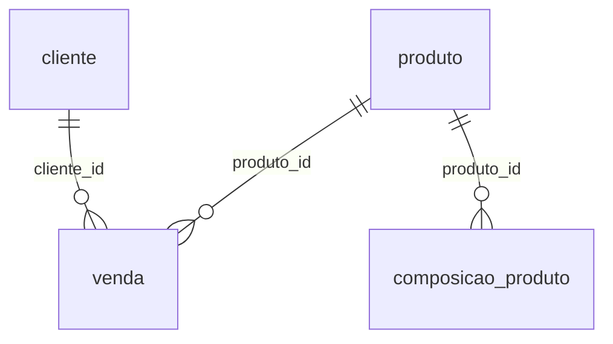
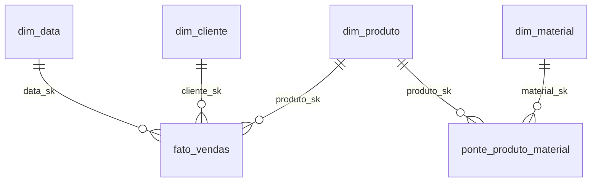

# Aula: do OLTP ao Star Schema — Vendas B2B de tubos e conexões

Cenário de uma fabricante de tubos e conexões (Tigre) que vende para empresas: distribuidores, home centers, construtoras, lojas de materiais e instaladoras. Os dados cobrem 2024 e 2025.

```
gerar_dados.py ──► CSVs ──► schema oltp (sistema de vendas) ──ETL──► schema dw (star schema) ──► BI
```

## Estrutura

```
aula-star-schema/
├── gerar_dados.py                    # gera os CSVs do sistema de vendas (OLTP)
├── executar_pipeline.py              # executa os SQLs 01, 02 e 03 no banco
├── docker-compose.yml                # PostgreSQL 16
└── sql/
    ├── 01_oltp_criar_e_carregar.sql  # 4 tabelas do sistema + carga dos CSVs
    ├── 02_dw_criar_tabelas.sql       # dimensões e fato
    ├── 03_etl_oltp_para_dw.sql       # transformação OLTP -> star schema
    └── consultas_analiticas.sql      # consultas OLAP para copiar no DBeaver
```

## Origem: OLTP (schema `oltp`)



| Tabela | Conteúdo |
|---|---|
| `cliente` | Empresas compradoras: CNPJ, segmento, cidade, UF. |
| `produto` | Catálogo com o preço **atual**. |
| `composicao_produto` | Materiais de cada produto e quantidade por unidade. |
| `venda` | 1 linha por item de pedido, com status `FATURADO` ou `CANCELADO` (~3%). |

## Destino: Star Schema (schema `dw`)



| Tabela | Papel |
|---|---|
| `fato_vendas` | Centro da estrela. **Grão: 1 linha = 1 item de 1 pedido faturado.** |
| `dim_data` | Quando: ano, trimestre, mês, dia da semana. |
| `dim_cliente` | Quem comprou: empresa, segmento, cidade, UF, região. |
| `dim_produto` | O que foi vendido: SKU, categoria, linha. |
| `dim_material` | Matérias-primas e componentes, com custo e fornecedor. |
| `ponte_produto_material` | Lista de materiais (BOM): liga a venda à matéria-prima. |

## O que o ETL faz

| Transformação | Exemplo |
|---|---|
| Surrogate keys | `cliente.id` (natural) → `dim_cliente.cliente_sk` (gerada no DW) |
| Enriquecimento | `regiao` derivada da `uf` em `dim_cliente` |
| Deduplicação | Materiais repetidos em `composicao_produto` → 1 linha por material em `dim_material` |
| Dimensão de tempo | `dim_data` gerada com `generate_series`; `venda.data_hora` vira `data_sk` |
| Regra de negócio | Vendas canceladas ficam fora da fato |
| Métricas pré-calculadas | `valor_bruto`, `valor_desconto`, `valor_liquido`, `custo_material` |

## Como executar

Pré-requisitos: Python 3 e Docker.

**1. Gerar os dados do sistema de vendas**
```bash
python3 gerar_dados.py
```

**2. Subir o PostgreSQL**
```bash
docker compose up -d --wait
```

**3. Criar OLTP, star schema e rodar o ETL**
```bash
pip install "psycopg[binary]"
python3 executar_pipeline.py
```
A conferência no final deve mostrar a mesma quantidade de linhas em `oltp.venda (faturadas)` e `dw.fato_vendas`. Pode ser executado de novo: recria tudo do zero.

**4. Consultar no DBeaver**

Crie uma conexão PostgreSQL:

| Host | Porta | Banco | Usuário | Senha |
|---|---|---|---|---|
| localhost | 5432 | dw_vendas | aula | aula |

Copie as consultas de `sql/consultas_analiticas.sql` para o editor SQL. A consulta 0 faz a mesma pergunta no OLTP e no star schema e retorna o mesmo resultado.

**Apagar tudo:** `docker compose down -v`.

## Observações

- `custo_material` considera só matéria-prima, com o custo vigente; por isso as margens são altas.
- Preços têm reajuste de 6% em 2025: o preço histórico vem de `venda`, não de `produto`.
- Nas consultas 8 e 9, a ponte multiplica as linhas da fato. Somar `valor_liquido` nesse JOIN duplica o valor.


1. Uma única resposta para “quanto vendemos?”

Peça para alguém calcular o faturamento direto no venda.csv ou no OLTP. Dependendo de quem faz, saem números diferentes:

Quem calculou	Como	Resultado
Analista A	SUM(quantidade * preco_unitario)	R$ 30,28 milhões
Analista B	Tirou o desconto, mas esqueceu os cancelados	R$ 26,39 milhões
Analista C	Tirou o desconto e os 97 pedidos cancelados	R$ 25,51 milhões ✅

A diferença entre o primeiro e o último é de quase R$ 5 milhões. O OLTP não está errado: ele só registra o que aconteceu, e as regras de “o que conta como venda” ficam na cabeça de quem consulta.

No star schema, o ETL aplica essas regras uma vez. Na fato só entram vendas faturadas, e o valor_liquido já vem calculado. Quem faz SUM(valor_liquido) chega em R$ 25,51 milhões, sempre.


... O star schema traduz os dados do formato do sistema para o formato do negócio ...

... Normalizar (OLTP) evita inconsistência ao gravar. Modelar em estrela evita inconsistência ao analisar. Deduplicar é consequência da normalização, não o objetivo do star schema ...


-----------------------------------------------------------------------

pedido ── item_pedido ── produto ── categoria
  │                        ├──── linha_produto
  │                        └──── estrutura_produto ── material ── fornecedor
  ├── status_pedido
  └── cliente ── endereco_cliente ── cidade ── estado ── regiao
         └──── segmento

Pergunta:

"faturamento de 2025 por região e linha de produto"

No OLTP:

SELECT r.nome AS regiao, lp.nome AS linha,
       SUM(ROUND(i.quantidade * i.preco_unitario, 2)
         - ROUND(i.quantidade * i.preco_unitario * i.percentual_desconto, 2)) AS faturamento
FROM item_pedido i
JOIN pedido p            ON p.id = i.pedido_id
JOIN status_pedido sp    ON sp.id = p.status_id
JOIN cliente c           ON c.id = p.cliente_id
JOIN endereco_cliente ec ON ec.cliente_id = c.id AND ec.tipo = 'FATURAMENTO'
JOIN cidade ci           ON ci.id = ec.cidade_id
JOIN estado e            ON e.id = ci.estado_id
JOIN regiao r            ON r.id = e.regiao_id
JOIN produto pr          ON pr.id = i.produto_id
JOIN linha_produto lp    ON lp.id = pr.linha_id
WHERE sp.codigo = 'FAT'
  AND p.data_emissao >= '2025-01-01' AND p.data_emissao < '2026-01-01'
GROUP BY r.nome, lp.nome;

São 10 tabelas, e quem escreve precisa saber de três regras escondidas:

qual código de status significa “faturado”;
que o cliente tem vários endereços e é preciso usar o de faturamento;
como calcular o valor líquido.

No star schema:

SELECT c.regiao, p.linha, SUM(f.valor_liquido) AS faturamento
FROM dw.fato_vendas f
JOIN dw.dim_cliente c ON c.cliente_sk = f.cliente_sk
JOIN dw.dim_produto p ON p.produto_sk = f.produto_sk
JOIN dw.dim_data    d ON d.data_sk    = f.data_sk
WHERE d.ano = 2025
GROUP BY c.regiao, p.linha;